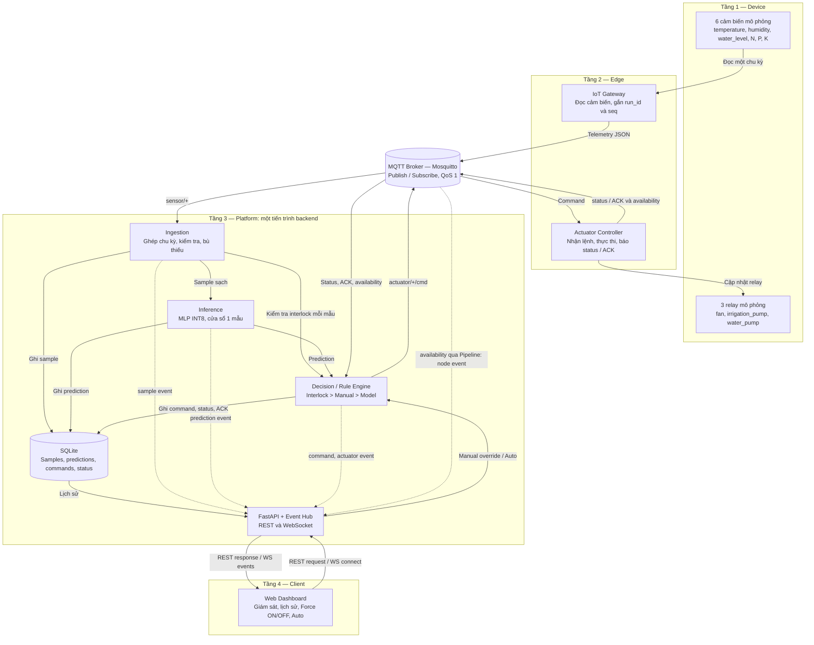
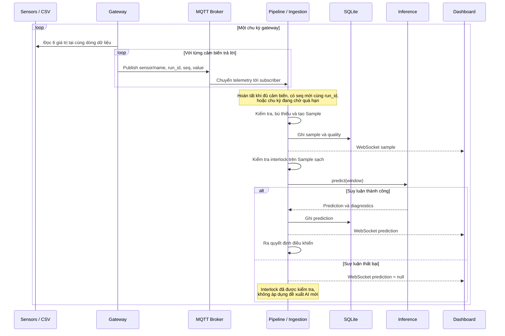
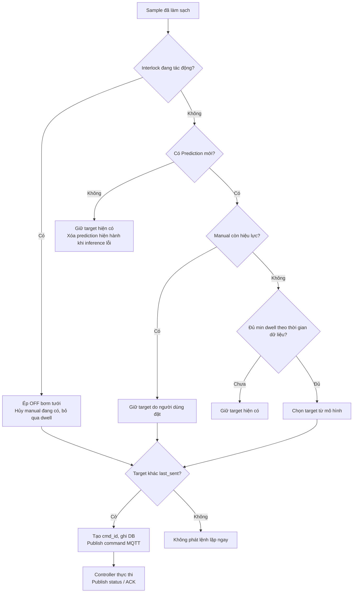
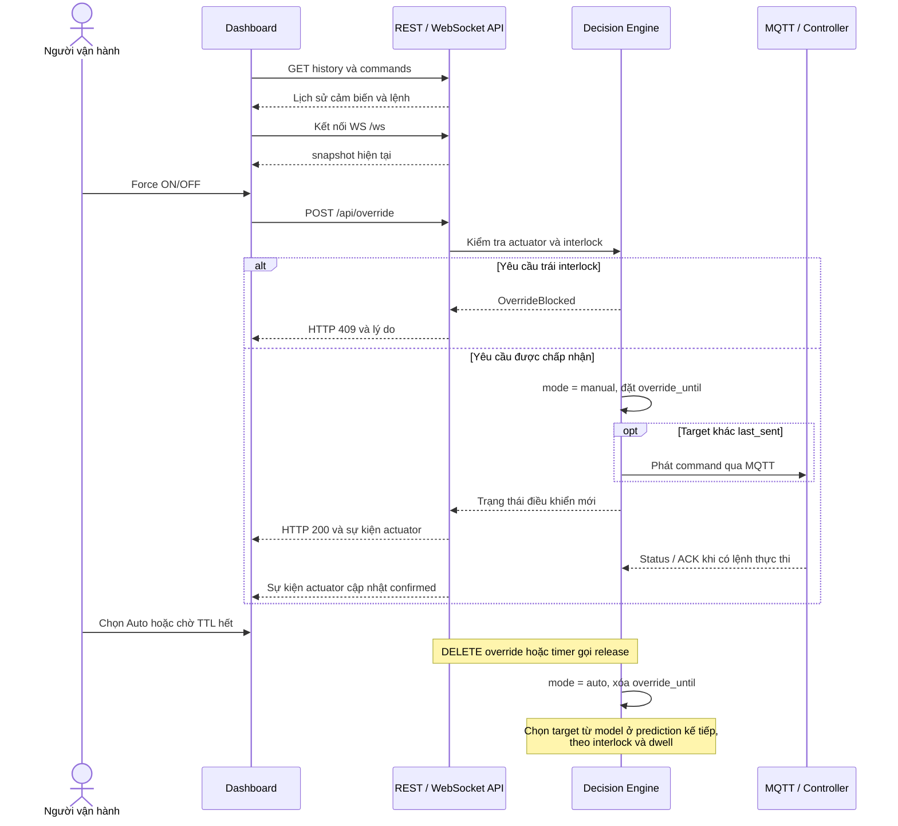
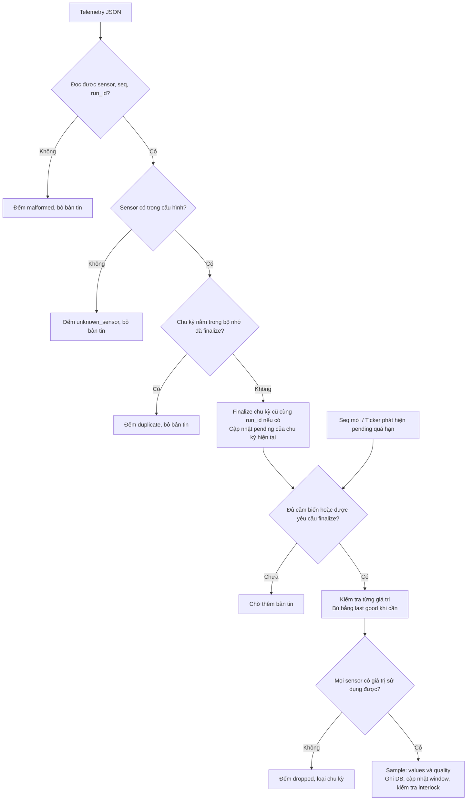
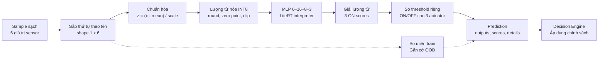
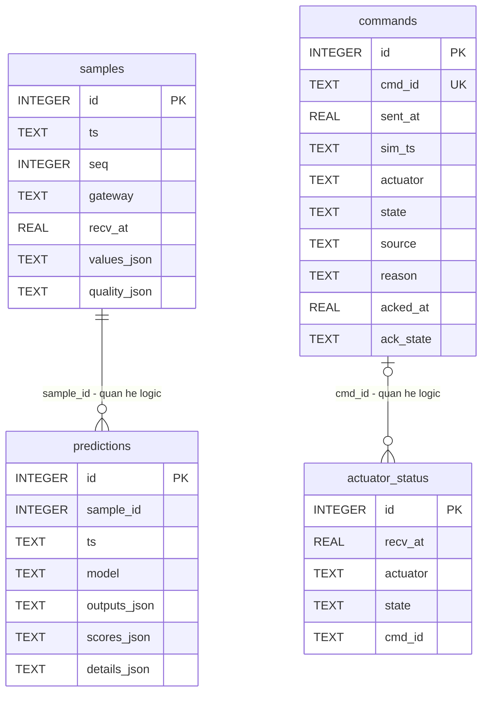

# Chương 3. Data Pipeline & Architecture

Chương này trình bày yêu cầu hệ thống, kiến trúc bốn tầng và quá trình chuyển đổi dữ liệu cảm biến thành quyết định điều khiển trong hệ thống nông nghiệp thông minh. Nội dung được đối chiếu với mã nguồn và cấu hình của repository `IoT_Agriculture_Architecture`, tại commit `e3024aa`.

Hệ thống hiện tại là một bản triển khai mô phỏng: dữ liệu CSV được phát lại qua sáu cảm biến phần mềm; relay được biểu diễn bằng trạng thái trong bộ nhớ. Các giao thức MQTT, REST, WebSocket, xử lý dữ liệu, suy luận MLP và lưu trữ SQLite được triển khai bằng mã thực. Các giao tiếp I2C, UART và GPIO trong cấu hình mô tả ánh xạ thiết bị dự kiến; repository chưa có driver đọc cảm biến hoặc đóng cắt tải vật lý.

## 3.1 Yêu cầu hệ thống

### 3.1.1 Yêu cầu chức năng

Hệ thống cần khép kín chu trình **thu thập → xử lý → suy luận → quyết định → thực thi → phản hồi**, đồng thời cho phép người dùng giám sát và can thiệp có kiểm soát.

| Mã | Yêu cầu | Cách thực hiện trong repository |
|---|---|---|
| FR01 | Thu thập dữ liệu môi trường và dinh dưỡng | Gateway đọc sáu cảm biến: `temperature`, `humidity`, `water_level`, `N`, `P`, `K`; mỗi cảm biến tương ứng một cột CSV. |
| FR02 | Truyền dữ liệu từ Edge lên Platform | Phát một bản tin JSON cho mỗi cảm biến trong một chu kỳ qua MQTT, QoS mặc định bằng 1. |
| FR03 | Tạo mẫu dữ liệu nhất quán | Ingestion ghép các bản tin theo `(run_id, seq)`, xử lý trùng, kiểm tra miền giá trị và bù dữ liệu thiếu bằng giá trị hợp lệ gần nhất. |
| FR04 | Suy luận trạng thái thiết bị | MLP nhận vector sáu đặc trưng và đề xuất ON/OFF cho quạt, bơm tưới và bơm nước. |
| FR05 | Áp dụng chính sách điều khiển | Decision Engine kết hợp interlock, manual override và dự đoán; áp dụng thời gian giữ trạng thái trong chế độ tự động. |
| FR06 | Thực thi và xác nhận lệnh | Controller nhận lệnh MQTT, cập nhật relay mô phỏng và gửi status kèm `cmd_id` làm ACK. |
| FR07 | Lưu lịch sử phục vụ truy vết | SQLite lưu mẫu đã làm sạch, dự đoán, lệnh và trạng thái do controller báo về. |
| FR08 | Giám sát trực tiếp | Dashboard hiển thị cảm biến, chất lượng dữ liệu, đề xuất mô hình, trạng thái xác nhận, chế độ điều khiển và tình trạng node. |
| FR09 | Điều khiển thủ công có thời hạn | REST API cho phép Force ON/OFF, đặt TTL và trả về Auto; yêu cầu trái interlock bị từ chối. |
| FR10 | Theo dõi kết nối và phục hồi truyền thông | MQTT có reconnect, tự đăng ký lại topic, retained availability và Last Will and Testament (LWT). |
| FR11 | Thay thế mô hình suy luận | Nạp lớp mô hình qua cấu hình `module:ClassName`, giữ giao diện `predict(window) → Prediction`. |

Các nhãn ON/OFF có trong CSV chỉ được dùng để đánh giá ngoại tuyến. Chúng không phải cảm biến và không đi vào vector đầu vào của mô hình khi hệ thống vận hành.

### 3.1.2 Yêu cầu phi chức năng

| Thuộc tính | Yêu cầu thiết kế | Mức hỗ trợ hiện tại |
|---|---|---|
| Tính kịp thời | Cập nhật theo chu kỳ và đẩy thay đổi tới giao diện | Gateway mặc định phát một chu kỳ mỗi 1 giây thực; WebSocket đẩy sự kiện. Chưa có cam kết độ trễ đầu cuối hoặc bảo đảm thời gian thực cứng. |
| Độ tin cậy | Hạn chế xử lý trùng và phát hiện lệnh chưa được xác nhận | Chống trùng ở ingestion; gửi lại lệnh khi `confirmed != desired` sau khoảng chờ. Chưa có bảo đảm exactly-once đầu cuối. |
| Tính nhất quán | Phối hợp dữ liệu MQTT, timer và API khi truy cập trạng thái | Pipeline dùng `RLock`; Database có khóa riêng; SQLite bật WAL. |
| Khả năng giải thích | Phân biệt đề xuất AI, quyết định và trạng thái xác nhận | Có `outputs`, `scores`, `desired`, `confirmed`, `reason`, `source` và lịch sử lệnh. |
| Khả năng mở rộng | Tách trách nhiệm thiết bị, Edge, Platform và Client | Có namespace topic theo `site`; cấu hình sensor/actuator tập trung. Một Pipeline hiện có một bộ cửa sổ và bộ giá trị bù chung, cần bổ sung phân vùng trước khi dùng nhiều gateway độc lập. |
| Khả năng bảo trì | Thay mô hình và nguồn dữ liệu với phạm vi sửa đổi nhỏ | Mô hình có adapter; gateway tách nguồn CSV khỏi pipeline; đường dẫn artifact giải theo thư mục cấu hình. |
| Khả năng tái lập | Dùng dữ liệu và artifact có sẵn trong repo | CSV, runtime và model INT8 được đóng gói; không cần checkout dự án huấn luyện bên cạnh. Vẫn cần cài các dependency khai báo. |
| An toàn điều khiển | Ràng buộc vận hành phải ưu tiên hơn AI và thao tác người dùng | Interlock mực nước được kiểm tra tại backend; chưa có watchdog hoặc interlock chạy cục bộ trên phần cứng. |
| Bảo mật | Xác thực, phân quyền và mã hóa khi triển khai thực tế | Chưa triển khai: broker cho phép anonymous, không TLS; API chưa có authentication/authorization. |
| Khả năng phục hồi | Phục hồi sau đứt kết nối hoặc khởi động lại | Có reconnect và status retained khi broker còn hoạt động; chưa có hàng đợi telemetry bền vững, phục hồi đầy đủ trạng thái điều khiển hoặc chuyển đổi dự phòng. |

Các con số cấu hình trong chương mô tả hành vi mặc định, không phải kết quả benchmark. Hiệu năng và độ tin cậy với thiết bị thật cần được đo riêng trong môi trường triển khai.

## 3.2 Kiến trúc tổng thể 4 tầng

Hệ thống phân chia thành bốn tầng theo trách nhiệm. Device biểu diễn đối tượng đo và chấp hành; Edge thực hiện thu thập và thực thi; Platform xử lý dữ liệu và quản lý chính sách; Client cung cấp giao diện vận hành. MQTT broker là hạ tầng truyền thông nối Edge với Platform, không phải một tầng nghiệp vụ thứ năm.



*Hình 3.1. Kiến trúc tổng thể bốn tầng và các đường truyền dữ liệu, điều khiển, phản hồi.*

Trong Hình 3.1, các đường tới SQLite và Event Hub là quan hệ logic. Việc gọi các thành phần, ghi cơ sở dữ liệu và phát sự kiện được điều phối tập trung bởi `Pipeline`; các thành phần Platform chưa được tách thành các microservice. Availability được Pipeline quản lý trong bản đồ `nodes`, còn status/ACK được chuyển tới Decision Engine.

| Tầng/thành phần | Trách nhiệm | Mã nguồn chính | Đơn vị thực thi |
|---|---|---|---|
| Device | Cung cấp giá trị cảm biến, duy trì trạng thái relay | `iot_agri/device/` | Đối tượng Python nằm trong gateway/controller |
| Edge — Gateway | Lấy mẫu, đóng gói và publish telemetry | `iot_agri/edge/gateway.py` | `python -m iot_agri.edge.gateway` |
| Edge — Controller | Subscribe lệnh, cập nhật relay, publish status | `iot_agri/edge/controller.py` | `python -m iot_agri.edge.controller` |
| MQTT broker | Trung chuyển bản tin giữa các tiến trình | `docker-compose.yml`, `mosquitto/mosquitto.conf` | Container Mosquitto |
| Platform | Ingestion, inference, quyết định, DB, API và sự kiện | `iot_agri/backend/` | `python -m iot_agri.backend` |
| Client | Hiển thị dữ liệu và gửi yêu cầu điều khiển | `iot_agri/client/static/index.html` | Trình duyệt web |

Phân tầng giúp thay cảm biến mô phỏng bằng thiết bị thật ở Device/Edge mà vẫn giữ hợp đồng telemetry. Tương tự, thay mô hình tương thích chỉ cần cấu hình adapter và artifact; giao diện điều khiển không phụ thuộc trực tiếp cấu trúc bên trong mạng nơ-ron.

## 3.3 Luồng dữ liệu và điều khiển

### 3.3.1 Luồng telemetry (Sensor → Platform)

Mỗi chu kỳ, Gateway đọc cùng một chỉ số dòng CSV cho tất cả cảm biến. Mỗi lần chạy gateway tạo một `run_id`; biến `seq` tăng theo chu kỳ, kể cả khi phát lại quay về đầu CSV. Gateway publish từng giá trị lên topic tương ứng thay vì gửi toàn bộ vector trong một bản tin.

Quy ước topic, mặc định `site = farm1`:

| Topic | Publisher → Subscriber | Dữ liệu | Retained |
|---|---|---|---|
| `agri/<site>/sensor/<name>` | Gateway → Backend | Một phép đo, mã chu kỳ và thời gian | Không |
| `agri/<site>/actuator/<name>/cmd` | Backend → Controller | Trạng thái đích, `cmd_id`, nguồn, lý do | Không |
| `agri/<site>/actuator/<name>/status` | Controller → Backend | Trạng thái báo về, `cmd_id`, `ok` | Có |
| `agri/<site>/node/<id>/availability` | Mỗi node; broker phát LWT khi mất kết nối bất thường → Backend | `online` hoặc `offline` | Có |
| `agri/<site>/node/<id>/meta` | Gateway → Subscriber quan tâm | Vai trò, cảm biến, chu kỳ phát và `run_id` | Có |

Pipeline hiện subscribe sensor, actuator status và availability. Topic `meta` được gateway phát để công bố cấu hình nhưng chưa được Pipeline dùng làm nguồn tự động cấu hình cảm biến.

Ví dụ một payload telemetry minh họa, với `gw_ts` là thời điểm thực gateway publish:

```json
{
  "sensor": "temperature",
  "value": 28.5,
  "unit": "°C",
  "interface": "I2C",
  "seq": 42,
  "run_id": "a1b2c3d4",
  "gw": "gw-01",
  "ts": "2024-02-08T06:10:00",
  "gw_ts": 1792764000.0
}
```

`ts` biểu diễn thời gian phép đo trong dữ liệu phát lại; `gw_ts` biểu diễn thời gian thực. Vì các bản tin riêng lẻ có thể thiếu hoặc được gửi lặp do QoS 1, backend chỉ tạo `Sample` sau bước ghép và làm sạch.



*Hình 3.2. Luồng telemetry từ thu thập đến lưu trữ và suy luận. Dashboard nhận sự kiện thông qua Event Hub.*

### 3.3.2 Luồng lệnh điều khiển (Platform → Actuator)

Kết quả MLP là **đề xuất trạng thái**, chưa phải lệnh cuối cùng. Với từng actuator, Decision Engine áp dụng thứ tự ưu tiên:

1. **Interlock:** ép trạng thái theo điều kiện an toàn. Cấu hình mặc định buộc `irrigation_pump = OFF` nếu `water_level < 10`.
2. **Manual override còn hiệu lực:** giữ trạng thái do người dùng yêu cầu nếu không bị interlock thay thế.
3. **Model/Auto:** nhận đề xuất mô hình khi đã thỏa thời gian giữ trạng thái tối thiểu.



*Hình 3.3. Chính sách tạo lệnh khi tiếp nhận mẫu/dự đoán. Timer gửi lại lệnh chưa xác nhận được mô tả riêng ở mục 3.3.3.*

`min_dwell_minutes = 10` dùng thời gian `ts` trong dữ liệu, không phải 10 phút thực. Khi thời gian dữ liệu lùi về đầu do phát lại vòng, engine cho phép vượt kiểm tra dwell. Điều này phù hợp bản demo nhưng cần thay bằng cơ chế thời gian đơn điệu khi vận hành thực tế. Manual override và interlock bỏ qua hạn chế dwell; manual vẫn phải qua interlock.

Khi trạng thái đích khác `last_sent`, backend tạo lệnh mới, ghi bảng `commands` rồi publish. Ví dụ minh họa:

```json
{
  "cmd_id": "123456abcdef",
  "actuator": "irrigation_pump",
  "state": "OFF",
  "source": "auto",
  "reason": "interlock: water_level=3 < 10",
  "ts": 1792764001.0
}
```

`source` nhận `auto`, `manual` hoặc `retry`; lý do interlock nằm trong `reason`. Controller kiểm tra tên actuator, chờ độ trễ mô phỏng mặc định `0.2 s`, gọi `RelayActuator.set()` và phát trạng thái. Phép đặt ON/OFF có tính lũy đẳng: đặt ON cho relay đang ON không tạo thêm thay đổi trạng thái.

### 3.3.3 Luồng phản hồi trạng thái / ACK

Status và ACK dùng chung topic `.../status`. Controller phát status có `cmd_id` sau khi xử lý lệnh; khi vừa kết nối, controller công bố trạng thái tất cả relay với `cmd_id = null`. Các status được retained để subscriber kết nối lại có thể nhận trạng thái gần nhất mà broker còn giữ.

| Trường status | Ý nghĩa |
|---|---|
| `actuator` | Tên relay do controller quản lý |
| `state` | Trạng thái relay mô phỏng tại thời điểm phản hồi |
| `cmd_id` | Lệnh đang được phản hồi; `null` nếu chỉ công bố trạng thái |
| `ok` | Việc áp dụng lệnh có thành công hay không |
| `ts` | Thời gian thực controller phát phản hồi |
| `error` | Nội dung lỗi nếu trạng thái lệnh không hợp lệ |

Khi nhận status, backend cập nhật `confirmed`, ghi bảng `actuator_status`, phát sự kiện `actuator`; nếu có `cmd_id` và `ok = true`, backend cập nhật `acked_at`, `ack_state` cho lệnh tương ứng. Dashboard dùng lịch sử lệnh để hiển thị ACK.

Timer của Pipeline chạy khoảng mỗi 1 giây thực. Nếu `desired` khác `confirmed` và đã qua `ack_timeout_s = 5` kể từ lần gửi trước, Decision Engine phát lại trạng thái đích với `source = retry`. **Mỗi lần retry có `cmd_id` mới** và một dòng lệnh mới; controller không dùng bộ nhớ chống trùng theo `cmd_id` mà dựa vào tính lũy đẳng của phép đặt trạng thái.

Có hai mức xác nhận cần phân biệt: ACK trong lịch sử lệnh được ghi theo `cmd_id` và `ok`; điều kiện dừng retry là `confirmed == desired`, không phải chỉ chờ ACK đúng mã lệnh mới nhất. Vì vậy một status phù hợp cũng có thể dừng retry; một ACK đến muộn cho trạng thái cũ có thể khiến backend tiếp tục gửi lại target hiện hành. Chưa có cơ chế sắp thứ tự/loại bỏ status cũ theo phiên điều khiển.

ACK hiện chứng minh controller đã cập nhật trạng thái relay **trong phần mềm**. Hệ thống chưa đo dòng điện, tốc độ quạt hoặc lưu lượng nước để xác nhận thiết bị vật lý thực sự hoạt động.

### 3.3.4 Luồng người dùng (REST, WebSocket, Manual override)

REST phục vụ truy vấn và thay đổi chế độ; WebSocket đẩy dữ liệu cập nhật tới client. Dashboard không publish trực tiếp MQTT nên các thao tác đều đi qua Decision Engine.

| Giao diện | Vai trò và hành vi |
|---|---|
| `GET /` | Trả trang Web Dashboard. |
| `GET /api/state` | Snapshot của site, model, sensor metadata, sample/prediction mới nhất, actuator, node và thống kê ingestion. |
| `GET /api/history?limit=200` | Mẫu cảm biến gần nhất; giới hạn từ 1 đến 5.000, trả từ cũ đến mới trong tập được chọn. |
| `GET /api/commands?limit=50` | Lệnh gần nhất, mới trước; giới hạn từ 1 đến 500. |
| `POST /api/override` | Nhận `{actuator, state, ttl_s}`; state là ON/OFF, TTL nếu có phải hữu hạn và lớn hơn 0. |
| `DELETE /api/override/{actuator}` | Chuyển actuator về Auto và xóa thời hạn override. |
| `WS /ws` | Gửi `snapshot` ngay sau kết nối; sau đó gửi `sample`, `prediction`, `command`, `actuator`, `node`. |



*Hình 3.4. Luồng giám sát và can thiệp thủ công của người vận hành.*

TTL mặc định là `300 s` thực. Khi người dùng chọn Auto hoặc TTL hết, hệ thống đổi chế độ nhưng không suy luận lại ngay; trạng thái đích Auto được tính ở dự đoán kế tiếp. Nếu không có mẫu/dự đoán mới, target trước đó có thể tiếp tục tồn tại. Khi interlock tác động trên mẫu mới, một override đang giữ bơm tưới ON sẽ bị hủy và bơm bị ép OFF.

API trả `404` nếu actuator không tồn tại, `409` nếu override trái interlock và `422` nếu payload không thỏa ràng buộc khai báo. HTTP 200 của override xác nhận backend đã tiếp nhận/chuyển chế độ; trạng thái thực thi phải được xem ở `confirmed` sau phản hồi controller.

## 3.4 Data Pipeline

### 3.4.1 Thu thập và tiền xử lý (Data Ingestion)

Pipeline có hai giai đoạn tiền xử lý khác nhau: làm sạch telemetry để tạo mẫu có thể sử dụng, sau đó chuẩn hóa số học theo artifact để suy luận. Việc kiểm tra miền hợp lệ của cảm biến không đồng nghĩa với kiểm tra miền đã xuất hiện trong tập huấn luyện.

**Nguồn và lịch phát dữ liệu.** `Dataset` đọc CSV, bỏ các dòng có trường `date` rỗng và sắp xếp ổn định theo `date`. Cột `tempreature` của dữ liệu gốc được cấu hình ánh xạ thành `temperature`. Với cấu hình mặc định, gateway phát một dòng mỗi `1.0 s` thực và quay lại đầu tập khi hết dữ liệu. Dữ liệu được mô tả theo bước đo 5 phút, nhưng có timestamp trùng; không nên giả định mọi cặp dòng sau sắp xếp đều cách nhau đúng 5 phút.

**Ghép chu kỳ.** Ingestion dùng khóa `(run_id, seq)` để tập hợp các bản tin. Một chu kỳ được kết thúc khi nhận đủ các cảm biến kỳ vọng, khi có `seq` lớn hơn trong cùng `run_id`, hoặc khi chu kỳ dở dang chờ quá `5 s` thực. Trường hợp cuối được kiểm tra bởi ticker khoảng mỗi giây, nên không phải deadline chính xác 5 giây. Nếu cả chu kỳ không có bản tin nào, backend không có pending cycle để tự tạo mẫu cho chu kỳ đó.

**Chống trùng.** Sau khi finalize, khóa chu kỳ được ghi vào bộ nhớ giới hạn 2.048 khóa. Bản tin tới lại của chu kỳ đã xử lý trong phạm vi bộ nhớ bị bỏ qua. Trong pending cycle, bản tin cùng tên sensor cập nhật cùng ô dữ liệu. Đây là chống trùng hữu hạn trong tiến trình; dữ liệu chống trùng không tồn tại sau khi backend khởi động lại.

**Kiểm tra và bù giá trị.** Backend từ chối sensor lạ, đếm bản tin thiếu định danh thiết yếu và kiểm tra giá trị phải là số hữu hạn, không phải boolean. Miền hợp lệ được khai báo như sau:

| Sensor | Đơn vị cấu hình | Miền hợp lệ | Giao tiếp được mô tả |
|---|---|---|---|
| `temperature` | °C | [-10, 60] | I2C |
| `humidity` | % | [0, 100] | I2C |
| `water_level` | % | [0, 100] | GPIO |
| `N` | mg/kg | [0, 300] | UART |
| `P` | mg/kg | [0, 300] | UART |
| `K` | mg/kg | [0, 300] | UART |

Giá trị hợp lệ được giữ và gắn `quality = ok`. Giá trị thiếu, sai kiểu hoặc không hữu hạn được thay bằng giá trị hợp lệ gần nhất với cờ `imputed_missing`; giá trị ngoài miền được thay tương tự với cờ `imputed_range`. Nếu chưa từng có giá trị hợp lệ cho một cảm biến cần bù, toàn bộ chu kỳ bị loại, không chạy inference. Các số 0 vẫn hợp lệ nếu nằm trong miền cấu hình.



*Hình 3.5. Các bước tiếp nhận và làm sạch dữ liệu. Khi seq mới đến, chu kỳ cũ được finalize trước khi tiếp tục ghép chu kỳ mới.*

Mỗi `Sample` chứa `seq`, `ts`, `gateway`, `values`, `quality` và thời điểm tạo mẫu `recv_at`. `recv_at` được gán khi tạo mẫu sau làm sạch, không phải thời điểm nhận từng bản tin sensor. `Sample.to_dict()` dùng cho API/WebSocket không bao gồm `recv_at`; thời điểm này vẫn được lưu trong SQLite.

Ví dụ: mẫu trước có `humidity = 55`; chu kỳ mới chỉ nhận được nhiệt độ và các sensor khác. Khi finalize, humidity được bù bằng 55 và gắn `imputed_missing`. Mẫu vẫn đủ sáu giá trị để suy luận, nhưng client có thể nhận biết giá trị humidity không phải phép đo mới.

### 3.4.2 Trích xuất đặc trưng (Feature vector / time window)

Pipeline lưu các mẫu sạch trong `deque` có độ dài tối đa bằng `backend.window_size`. Với mô hình mặc định `AIoTMLP`, cả yêu cầu mô hình và cấu hình đều dùng **một mẫu**; hệ thống chưa tính rolling mean, độ dốc hay các đặc trưng chuỗi thời gian.

Vector đầu vào của MLP được lấy theo tên sensor và sắp xếp theo thứ tự cố định trong artifact:

```text
x(t) = [temperature, humidity, water_level, N, P, K]
shape = [1, 6]
```

Adapter xác nhận tập tên sensor/actuator tương thích; runtime dùng thứ tự feature của artifact, không phụ thuộc thứ tự các khóa trong JSON. Các trường `seq`, `run_id`, `gateway`, timestamp, đơn vị và `quality` không được đưa vào vector số của MLP. Vì vậy mô hình hiện tại chưa biết trực tiếp đặc trưng nào vừa được bù dữ liệu.



*Hình 3.6. Biến đổi vector cảm biến thành đề xuất điều khiển của mô hình INT8.*

Quá trình suy luận gồm các bước:

1. Lấy sáu giá trị số hữu hạn từ mẫu mới nhất.
2. Đối chiếu mỗi giá trị với `minimum`/`maximum` trong `preprocessing.json` để gắn cờ ngoài miền huấn luyện.
3. Chuẩn hóa bằng `z_i = (x_i - mean_i) / scale_i`; thống kê được lưu từ tập train, không fit lại khi chạy.
4. Với INT8, lượng tử hóa `q_i = clip(round(z_i / s_in) + zero_in, -128, 127)` theo metadata tensor thực tế.
5. Chạy interpreter đã được nạp và cấp phát tensor một lần ở bước khởi tạo.
6. Giải lượng tử output theo `p_i = (q_out_i - zero_out) * s_out` và so threshold riêng cho từng actuator.
7. Tạo `Prediction`, lưu DB, đẩy tới client và chuyển cho Decision Engine.

| Thứ tự output | Actuator | Threshold ON xấp xỉ | Quy tắc |
|---|---|---|---|
| 1 | `fan` | 0,50 | ON nếu score ≥ threshold |
| 2 | `irrigation_pump` | 0,52 | ON nếu score ≥ threshold |
| 3 | `water_pump` | 0,74 | ON nếu score ≥ threshold |

`Prediction.details` chứa phiên bản mô hình, phiên bản tiền xử lý, biến thể, trạng thái dữ liệu, danh sách feature ngoài miền train và `inference_ms`. Thời gian này đo phần xử lý trong `predict_sensors()` từ chuẩn bị vector đến tạo kết quả; không bao gồm truyền MQTT, ghi DB, chờ relay hoặc cập nhật trình duyệt. ON score là đầu ra mô hình, chưa phải chứng nhận độ tin cậy đã hiệu chỉnh.

Ví dụ, `temperature = 45 °C` nằm trong miền cảm biến [-10, 60] nên ingestion giữ nguyên, nhưng vượt cực đại train 36 °C nên runtime gắn `out_of_training_range`. Hiện hệ thống vẫn suy luận và có thể ra lệnh từ mẫu đó; cờ OOD chưa tự kích hoạt chính sách dự phòng.

Giao diện mô hình có hỗ trợ cửa sổ nhiều mẫu: `predict(window)` nhận mẫu từ cũ đến mới, và `InferenceService` đệm đầu bằng mẫu đầu tiên khi chưa đủ lịch sử. Pipeline kiểm tra dung lượng buffer phải đáp ứng `model.window_size`. Tăng riêng cấu hình buffer không biến MLP hiện tại thành mô hình thời gian; adapter này vẫn chỉ dùng mẫu cuối.

Nếu suy luận phát sinh exception, dịch vụ trả `None`; Pipeline xóa dự đoán hiện hành và phát `prediction = null`. Interlock đã được kiểm tra trước suy luận nên vẫn có thể ép bơm OFF. Những target không bị interlock tác động tiếp tục giữ giá trị trước; hệ thống chưa tự chuyển sang mô hình ngưỡng khi MLP lỗi.

### 3.4.3 Lưu trữ (Database) và schema

SQLite được chọn cho triển khai mô phỏng gọn trong một backend. Đường dẫn mặc định là `data/agri.db`, được giải tương đối theo file cấu hình. Chế độ WAL và khóa truy cập giúp phối hợp các thao tác từ MQTT thread, ticker và API; mỗi lần ghi được commit riêng, nên toàn bộ quá trình từ sample đến command chưa phải một transaction nguyên tử.



*Hình 3.7. Schema lưu trữ thực tế. Quan hệ trong hình là liên kết logic; DDL hiện chưa khai báo ràng buộc FOREIGN KEY.*

| Bảng | Đơn vị lưu | Ý nghĩa truy vết |
|---|---|---|
| `samples` | Một chu kỳ sử dụng được sau làm sạch | Xem vector đầu vào và cờ chất lượng tại thời điểm đo. Không lưu riêng từng raw telemetry. |
| `predictions` | Một dự đoán thành công của một sample | Xem output, ON score, phiên bản mô hình và diagnostics. Mẫu có suy luận lỗi không có dòng prediction tương ứng. |
| `commands` | Một lần phát lệnh, kể cả retry | Xem actuator, trạng thái yêu cầu, nguồn, lý do, thời gian gửi và ACK theo mã lệnh. |
| `actuator_status` | Một phản hồi từ controller | Xem trạng thái báo về và mã lệnh nếu có; schema hiện không lưu `ok` hoặc nội dung `error`. |

`values_json`, `quality_json`, `outputs_json`, `scores_json` và `details_json` là JSON được serialize vào cột TEXT. Schema giữ tính linh hoạt nhưng chưa tối ưu cho truy vấn tổng hợp dài hạn theo từng sensor. Các index được tạo ngầm cho khóa chính và `commands.cmd_id UNIQUE`; chưa có index thời gian riêng, chính sách retention hay partition.

Một số ranh giới truy vết cần lưu ý:

- `sample_id` liên kết prediction với sample, nhưng command chưa có cột `prediction_id` hoặc `sample_id`; việc lần ngược từ lệnh đến dự đoán phải dựa vào thời gian/ngữ cảnh và `reason`.
- `run_id` chỉ được dùng trong ingestion; không được lưu trong `samples`. Cặp `(gateway, seq)` không đủ để xác định duy nhất chu kỳ qua nhiều lần khởi động gateway.
- `site` không nằm trong các bảng; snapshot lấy site từ cấu hình. Dùng một DB chung cho nhiều site sẽ cần bổ sung định danh và phân vùng dữ liệu.
- `gw_ts` và raw payload không được lưu; `recv_at` trong `samples` là thời điểm tạo mẫu. Không thể dùng DB hiện tại để đo chính xác mọi chặng truyền telemetry.
- `details_json` được bổ sung tự động nếu mở một DB cũ chưa có cột này. Cơ chế này chỉ là migration cụ thể, chưa phải hệ thống quản lý phiên bản schema tổng quát.

REST hiện cung cấp lịch sử samples và commands; chưa có endpoint lịch sử predictions hoặc actuator status riêng. Trạng thái node, cửa sổ mẫu, bộ nhớ chống trùng, manual override và các target đang điều khiển nằm trong RAM, chưa được tái dựng đầy đủ từ DB khi backend khởi động lại.

## 3.5 Thiết kế các thành phần

### 3.5.1 Edge: IoT Gateway và Actuator Controller

**IoT Gateway.** `Gateway` tách trách nhiệm lấy mẫu khỏi xử lý nghiệp vụ. Nó nạp cấu hình, tạo danh sách `SimulatedSensor`, sinh `run_id`, đọc một chu kỳ rồi publish các bản tin. Các tùy chọn dòng lệnh cho phép thay khoảng phát, bắt đầu tại dòng chỉ định, giới hạn số mẫu và tắt phát lại vòng. `dropout_prob` mặc định bằng 0; khi tăng, một số sensor không trả lời để mô phỏng thiếu dữ liệu. Gateway hiện chưa có bộ đệm đĩa hay cơ chế phát bù lịch sử sau mất mạng.

**Actuator Controller.** `ActuatorController` tạo ba relay từ cấu hình, subscribe `actuator/+/cmd`, thực thi lệnh và phát status retained. Relay khởi tạo OFF trong bộ nhớ; việc khai báo các chân 17, 27, 22 chưa thực hiện ghi GPIO thật. Mỗi lần reconnect, controller công bố lại toàn bộ trạng thái relay. Độ trễ mô phỏng nằm ngay trong callback nhận lệnh, nên một lệnh đang xử lý cũng làm chậm xử lý các lệnh tiếp theo trên network thread của controller.

**MQTT dùng chung.** `MqttNode` chịu trách nhiệm mã hóa/giải mã JSON, đăng ký callback, publish, reconnect với khoảng trì hoãn 1–10 giây và subscribe lại sau khi kết nối. Mỗi node có availability retained; LWT báo offline khi broker phát hiện mất kết nối bất thường, còn dừng bình thường chủ động publish offline. Availability không phải tín hiệu độ mới của từng cảm biến và không trực tiếp buộc relay về trạng thái an toàn.

**Hướng triển khai phần cứng.** Có thể thay `SimulatedSensor.read()` bằng thao tác đọc I2C/UART/GPIO và thay `RelayActuator.set()` bằng driver relay. Khi đó cần hiệu chuẩn đơn vị cảm biến, kiểm tra polarity relay, xác định trạng thái khi boot và bổ sung interlock/watchdog cục bộ. Đây là phần mở rộng thiết kế, chưa có trong repository.

### 3.5.2 Platform: Ingestion, Inference, Rule Engine, REST/WebSocket

Platform được tổ chức thành các module cộng tác trong một tiến trình:

| Module | Đầu vào | Đầu ra/trách nhiệm |
|---|---|---|
| `ingestion.py` | Telemetry theo sensor | `Sample` sạch, quality và bộ đếm `malformed`, `unknown_sensor`, `duplicate`, `dropped`, `samples`. |
| `inference.py` | Cửa sổ `Sample` | Hợp đồng mô hình, nạp plugin, xử lý lỗi suy luận. |
| `models/aiot_mlp.py` | Sample mới nhất | Ánh xạ tên sensor/actuator, chuyển kết quả runtime thành `Prediction`. |
| `models/mlp_runtime.py` | Vector sensor và artifact | Chuẩn hóa, OOD, lượng tử hóa, gọi LiteRT và so threshold. |
| `decision.py` | Sample, prediction, override, status và timer | Target actuator, lệnh, retry và trạng thái chế độ. |
| `db.py` | Sample, prediction, command, status | Lưu SQLite và truy vấn lịch sử. |
| `pipeline.py` | Sự kiện MQTT/API/timer | Điều phối các module, lưu trạng thái mới nhất và phát sự kiện. |
| `app.py` | HTTP/WebSocket | REST, static dashboard, Event Hub và quản lý vòng đời backend. |

Trong một mẫu hợp lệ, Pipeline thực hiện theo thứ tự: ghi sample → cập nhật cửa sổ và latest sample → phát `sample` → kiểm tra interlock → suy luận → ghi/phát prediction thành công → áp dụng quyết định từ prediction. Status và availability đi theo callback riêng, không cần chờ chu kỳ suy luận mới.

Có ba nguồn thực thi cùng chạm trạng thái: network thread của Paho, ticker và request API. `RLock` trong Pipeline bảo vệ các thao tác này; Database dùng một khóa riêng cho connection SQLite chia sẻ. Cách tổ chức đơn giản cho bản mô phỏng, nhưng suy luận hoặc ghi DB chậm trong vùng khóa có thể làm các thao tác khác phải chờ.

Event Hub chuyển sự kiện từ thread nền sang vòng lặp `asyncio` qua `call_soon_threadsafe`. Mỗi client WebSocket có queue tối đa 500 sự kiện; nếu queue đầy, sự kiện mới cho client đó bị bỏ để tránh chặn pipeline. Không có replay sự kiện bị bỏ hoặc số thứ tự sự kiện để client phát hiện mất bản tin. Khi kết nối lại, snapshot và các truy vấn lịch sử giúp lấy lại trạng thái, nhưng không bảo đảm nhận đủ mọi sự kiện đã xảy ra.

Mô hình mặc định chạy **tại Platform**, dù lớp runtime có tên `EdgeModel` và artifact INT8 phù hợp triển khai gọn. Repository chưa chạy inference trên gateway/controller. Ngoài ra, lớp `ThresholdModel` có sẵn để cấu hình thay thế, nhưng không tự động được dùng khi MLP thất bại. Biến thể FP32 cần file `model_fp32.tflite` tương ứng; file hiện có trong bundle được kiểm tra là `model_int8.tflite`.

### 3.5.3 Client: Web/Mobile Dashboard

Client hiện là một trang HTML/CSS/JavaScript do FastAPI phục vụ, có bố cục thích ứng kích thước màn hình. Có thể mở bằng trình duyệt trên điện thoại; chưa có ứng dụng mobile native riêng.

Dashboard khởi động bằng cách tải lịch sử cảm biến và lệnh qua REST, sau đó mở WebSocket. Snapshot đầu tiên cung cấp metadata và trạng thái hiện hành để tạo giao diện. Các sự kiện tiếp theo cập nhật từng vùng hiển thị:

- **Sensors:** sáu giá trị, đơn vị, cờ bù dữ liệu và biểu đồ đường nhỏ; lịch sử phía trình duyệt giữ khoảng 120 mẫu.
- **Model prediction:** ON/OFF được mô hình đề xuất, ON score, tên mô hình, thời gian suy luận và cảnh báo ngoài miền train.
- **Actuators:** `confirmed` do controller báo, target đang chờ nếu khác `desired`, mode Auto/Manual, hạn override và `reason`.
- **Recent commands:** 15 lệnh gần nhất với thời gian dữ liệu, nguồn lệnh, lý do và dấu ACK.
- **Connectivity:** tình trạng WebSocket và các node MQTT theo availability.

Force ON/OFF gọi API override; Auto gọi DELETE override. Lỗi interlock được hiển thị từ phản hồi API. Khi WebSocket đóng, client thử khởi tạo lại sau 2 giây. Việc tách khu vực đề xuất mô hình khỏi actuator giúp người dùng thấy rõ trường hợp AI đề xuất ON nhưng interlock buộc OFF, hoặc lệnh đã gửi mà controller chưa xác nhận.

## 3.6 Cơ chế an toàn và dự phòng

An toàn trong bản hiện tại được thực hiện chủ yếu tại backend. Interlock mực nước là ràng buộc điều khiển rõ ràng nhất: khi `water_level < 10 %`, bơm tưới bị ép OFF, ưu tiên hơn AI, manual override và dwell. Kiểm tra này chạy trên mỗi Sample sạch trước suy luận, nên lỗi mô hình không làm bỏ qua interlock của mẫu đang xử lý.

Tuy nhiên, Sample sạch có thể chứa giá trị bù từ quá khứ. Backend chưa giới hạn tuổi của `last_good` hoặc thời gian kể từ phép đo mới nhất; do đó interlock trên dữ liệu đã bù chưa tương đương một bảo vệ chống cạn bằng cảm biến vật lý độc lập.

| Sự cố/tình huống | Hành vi hiện có | Giới hạn và hướng bổ sung |
|---|---|---|
| Thiếu một sensor hoặc giá trị ngoài miền | Bù giá trị hợp lệ gần nhất, gắn quality; bỏ mẫu nếu không có giá trị để bù | Cần giới hạn tuổi dữ liệu bù và chính sách an toàn theo chất lượng mẫu. |
| Pending cycle dừng giữa chừng | Finalize khi chờ quá 5 giây, được ticker kiểm tra | Đây là timeout ghép mẫu; chưa phải timeout độ mới của cả nguồn dữ liệu. |
| Mất toàn bộ telemetry | Không có mẫu mới; target trước đó có thể tiếp tục được giữ/gửi lại | Cần heartbeat/timeout freshness và chính sách trạng thái an toàn. |
| MLP phát sinh lỗi lúc suy luận | Xóa current prediction; interlock vẫn được kiểm tra trên mẫu; giữ các target còn lại | Chưa có chuyển tự động sang rule baseline hoặc tắt toàn bộ actuator. |
| Artifact lỗi/không tương thích lúc khởi tạo | Kiểm tra thứ tự, preprocessing, threshold, shape/dtype tensor; lỗi có thể ngăn backend khởi động | Cần quản lý phiên bản, kiểm tra trước cập nhật và quy trình rollback bundle. |
| Mực nước dưới ngưỡng | Ép OFF bơm tưới, hủy manual đang có, bỏ qua dwell | Phụ thuộc backend, broker, controller và chất lượng dữ liệu; cần bảo vệ tại thiết bị thật. |
| Dao động dự đoán quanh ranh giới ON/OFF | Giữ trạng thái tối thiểu 10 phút theo dữ liệu trong Auto | Cần thời gian đơn điệu cho vận hành thật; không dùng dwell để trì hoãn interlock. |
| Chưa nhận trạng thái đích | Retry sau khoảng chờ 5 giây, mỗi lần có mã lệnh mới | Chưa có giới hạn retry, backoff riêng, mức báo động hoặc xác nhận tác động vật lý. |
| MQTT mất kết nối tạm thời | Reconnect, subscribe lại, availability LWT | Không có hàng đợi telemetry bền vững; không bảo đảm khôi phục mọi bản tin trong khoảng mất mạng. |
| Broker restart | Container có `restart: unless-stopped`; client có thể kết nối lại | `persistence false`: retained không bền qua restart; một broker duy nhất chưa có chuyển đổi dự phòng. |
| Backend restart | Đọc lại DB; khi subscribe có thể nhận retained status nếu broker còn giữ | Không phục hồi đầy đủ override, desired, window và dedup từ DB. |
| Controller restart | Relay mô phỏng khởi tạo OFF và công bố trạng thái khi kết nối | Chưa xác định/chứng minh trạng thái GPIO vật lý khi boot; target backend có thể được gửi lại sau đó. |
| Manual bị bỏ quên | TTL mặc định 300 giây thực; hết hạn chuyển Auto | Cần prediction mới để chọn lại target; chưa có chính sách riêng khi đồng thời mất telemetry. |
| Client chậm/mất WebSocket | Queue giới hạn, bỏ event khi đầy; reconnect và snapshot | Client có thể mất các sự kiện trung gian; chưa có xác nhận/chạy lại luồng sự kiện. |
| Truy cập trái phép | Chưa có cơ chế kiểm soát trong cấu hình hiện tại | Cần authentication/authorization cho API, ACL topic MQTT và TLS trước khi dùng ngoài môi trường demo. |

Đối với triển khai thực tế, các bước mở rộng ưu tiên là: đặt interlock/watchdog tại controller và xác định trạng thái fail-safe; kiểm tra freshness theo từng sensor; bổ sung xác thực và mã hóa; sau đó bổ sung lưu đệm telemetry, phục hồi trạng thái điều khiển và sao lưu/retention dữ liệu. Các cơ chế này là đề xuất hoàn thiện, không được xem là đã triển khai chỉ từ sơ đồ phân tầng.

### Mã nguồn đối chiếu

Các đường dẫn sau tương đối từ file tài liệu này, phục vụ kiểm tra mô tả với triển khai:

| Nội dung | Nguồn |
|---|---|
| Cấu hình mặc định | [config.yaml](../config.yaml) |
| Ánh xạ topic và hành vi MQTT | [topics.py](../iot_agri/topics.py), [mqtt.py](../iot_agri/mqtt.py) |
| Nguồn mô phỏng và thiết bị | [dataset.py](../iot_agri/device/dataset.py), [sensors.py](../iot_agri/device/sensors.py), [actuators.py](../iot_agri/device/actuators.py) |
| Thu thập và thực thi ở Edge | [gateway.py](../iot_agri/edge/gateway.py), [controller.py](../iot_agri/edge/controller.py) |
| Ghép và làm sạch mẫu | [ingestion.py](../iot_agri/backend/ingestion.py) |
| Cửa sổ và hợp đồng suy luận | [inference.py](../iot_agri/backend/inference.py) |
| MLP và tiền xử lý | [aiot_mlp.py](../iot_agri/backend/models/aiot_mlp.py), [mlp_runtime.py](../iot_agri/backend/models/mlp_runtime.py), [preprocessing.json](../models/mlp_v1/preprocessing.json), [thresholds.json](../models/mlp_v1/thresholds.json), [model_metadata.json](../models/mlp_v1/model_metadata.json) |
| Luật, ưu tiên, TTL và retry | [decision.py](../iot_agri/backend/decision.py) |
| Điều phối, luồng thực thi và timer | [pipeline.py](../iot_agri/backend/pipeline.py) |
| Database và schema | [db.py](../iot_agri/backend/db.py) |
| API, WebSocket và Dashboard | [app.py](../iot_agri/backend/app.py), [index.html](../iot_agri/client/static/index.html) |
| Broker và khởi chạy | [docker-compose.yml](../docker-compose.yml), [mosquitto.conf](../mosquitto/mosquitto.conf), [run_all.sh](../scripts/run_all.sh) |

Các sơ đồ được nhúng trực tiếp trong khối `mermaid`. Mở file bằng trình xem Markdown có hỗ trợ Mermaid để hiển thị hình; ở trình xem chưa hỗ trợ, mã sơ đồ vẫn có thể sao chép để render.
